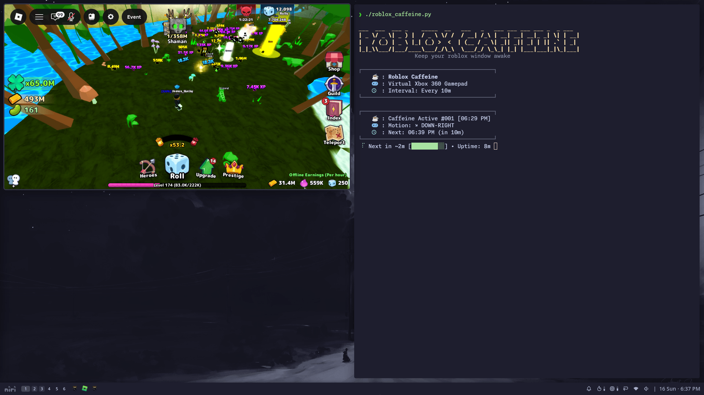

<div align="center">

```text
 ___  ___  ___ _    _____  __   ___   _   ___ ___ ___ ___ _  _ ___ 
| _ \/ _ \| _ ) |  / _ \ \/ /  / __| /_\ | __| __| __|_ _| \| | __|
|   / (_) | _ \ |_| (_) >  <  | (__ / _ \| _|| _|| _| | || .` | _| 
|_|_\\___/|___/____\___/_/\_\  \___/_/ \_\_| |_| |___|___|_|\_|___|
```

### Keep your Roblox window awake on Linux

[](https://github.com/EbadShelby/roblox-caffeine/releases)
[](https://www.python.org/)
[-orange.svg?style=flat-square&logo=linux&logoColor=white)](https://kernel.org/)
[](https://sober.vinegarhq.org/)
[](LICENSE)

*A minimalist, zero-focus-stealing keep-alive utility that prevents Roblox's 20-minute inactivity kick via kernel gamepad emulation.*

</div>

---

## Why Roblox Caffeine?

Traditional anti-AFK methods on Linux like auto-clickers or Lua injectors either **break on Wayland**, **hijack your keyboard/mouse**, or **risk getting your account banned**.

**Roblox Caffeine** takes a hardware-level approach:
- **Native Virtual Gamepad**: Emulates a full Microsoft Xbox 360 controller directly at the Linux kernel level (`/dev/uinput`).
- **Zero Focus Stealing**: Runs completely in the background. You can type, code, or play other games while Roblox stays awake on another workspace or minimized.
- **Wayland Compatible**: Operates beneath the display server, meaning it works cleanly on **Wayland** (Niri, GNOME, KDE, Hyprland, Sway) and **X11**.
- **Safe & Legitimate**: Zero memory injection, zero DLL hooking, and zero client tampering.

---

## Preview

<p align="center">
  
</p>

```text
┌────────────────────────────────────────┐
    ☕ : Roblox Caffeine
      : Virtual Xbox 360 Gamepad
    󰅐  : Interval: Every 5m
└────────────────────────────────────────┘

┌────────────────────────────────────────┐
    ☕ : Caffeine Active #001 [05:42 PM]
      : Action: ↗ UP-RIGHT + Jump
    󰅐  : Next: 05:47 PM (in 5m)
└────────────────────────────────────────┘
 ⠋ Next in ~4m [██░░░░░░░░] • Uptime: 0m
```

---

## Installation & Setup

### 1. Install Roblox Caffeine

**Option A: via pipx (Recommended - handles dependencies automatically)**:
```bash
pipx install git+https://github.com/EbadShelby/roblox-caffeine.git
```

**Option B: Manual / Clone**:
1. Install Python `evdev` for your distribution:
   - **Fedora / RHEL**: `sudo dnf install python3-evdev`
   - **Arch Linux / Manjaro**: `sudo pacman -S python-evdev`
   - **Ubuntu / Debian**: `sudo apt install python3-evdev`
   - **openSUSE**: `sudo zypper install python3-evdev`
   - **Universal**: `pip install evdev`

2. Clone & install executable:
   ```bash
   git clone https://github.com/EbadShelby/roblox-caffeine.git
   cd roblox-caffeine
   ./install.sh
   ```

---

### 2. Configure `/dev/uinput` Permissions (Run without `sudo`)

Run the automated setup command:
```bash
roblox-caffeine --setup
```
*(Prompts for `sudo` to set up udev rules, group permissions, and kernel module automatically).*

<details>
<summary><b>Or configure manually</b></summary>

1. Add your user to the `input` group:
   ```bash
   sudo usermod -aG input $USER
   ```

2. Install the udev rule (`/etc/udev/rules.d/99-uinput.rules`):
   ```bash
   echo 'KERNEL=="uinput", GROUP="input", MODE="0660", OPTIONS+="static_node=uinput"' | sudo tee /etc/udev/rules.d/99-uinput.rules
   ```

3. Reload udev rules & load the module:
   ```bash
   sudo udevadm control --reload-rules && sudo udevadm trigger
   sudo modprobe uinput
   ```

4. Reboot or log out for group permissions to apply.
</details>

---

### 3. Configure Sober & Gamescope

Because **Sober** runs inside a Flatpak sandbox and recent updates (`Sober 1.8.0+`) ignore gamepad input whenever the Sober window loses focus, you need two things for true **zero-focus-stealing** background AFK:

1. **Allow Sober to access input devices**:
   ```bash
   flatpak override --user --device=all org.vinegarhq.Sober
   ```

2. **Verify gamepad support in Sober configuration**:
   Ensure `"allow_gamepad_permission": true` is set in `~/.var/app/org.vinegarhq.Sober/config/sober/config.json` (or via Sober App Settings):
   ```json
   {
     "allow_gamepad_permission": true
   }
   ```

3. **Install `gamescope`** (runs Sober in its own lightweight micro-compositor so Sober always stays focused even on another workspace, while capping unfocused FPS to 15 to save GPU/battery):
   - **Fedora / RHEL**: `sudo dnf install gamescope`
   - **Arch Linux / Manjaro**: `sudo pacman -S gamescope`
   - **Ubuntu / Debian**: `sudo apt install gamescope`
   - **openSUSE**: `sudo zypper install gamescope`

---

## Usage

**All-in-one (Recommended)** — launches Sober inside `gamescope` and starts Roblox Caffeine in one command:
```bash
roblox-caffeine --launch
```

**Or launch them separately:**
```bash
# Terminal 1: Launch Sober inside gamescope (keeps focus in background + working mouse/camera)
gamescope --backend sdl -W 1280 -H 720 -w 1280 -h 720 -o 15 --force-grab-cursor --force-windows-fullscreen -- flatpak run --nosocket=wayland --socket=x11 org.vinegarhq.Sober

# Terminal 2: Start Roblox Caffeine
roblox-caffeine
```

> **Tip:** Because `--force-grab-cursor` enables Roblox camera rotation inside `gamescope`, use your window manager's normal shortcut (e.g. `Super` + workspace/window keybind in Niri/Hyprland/Sway) to move away from the `gamescope` window. Roblox stays awake on its own workspace with zero focus stealing.

*Roblox Caffeine pulses every 5 minutes by default, sending a discrete button press (`A` / Jump) + balanced thumbstick nudge to keep your session awake without stealing mouse or window focus.*

### Options
- `-l, --launch`: Launch Sober inside `gamescope` alongside Roblox Caffeine.
- `--res WxH`: Custom `gamescope` window resolution for `--launch` (default: `1280x720`).
- `-i, --interval MIN`: Custom pulse interval in minutes (1–15, default: `5`).
- `--no-jump`: Use a subtle `L3` click + camera nudge instead of jumping/walking (useful when sitting or perched on a ledge).
- `--test`: Fire a single test pulse immediately and exit.
- `-s, --setup`: Configure `/dev/uinput` permissions with `sudo`.
- `-h, --help`: Show usage help.

---

## Comparison with Other Solutions

| Feature | Roblox Caffeine | Auto-Clicker | Lua Injectors |
| :--- | :---: | :---: | :---: |
| **Works in Background** | Yes | No | Yes |
| **Wayland Ready** | Yes | sometimes broken | No |
| **No Focus Stealing** | Yes | Steals input | Yes |
| **Anticheat Safe** | 100% Safe | Safe | High Ban Risk |

---

## FAQ & Troubleshooting

<details>
<summary><b>Character only moves when Roblox/Sober is focused?</b></summary>

Recent Sober updates (`1.8.0+`) ignore gamepad events whenever the Sober window loses focus (even with `SDL_JOYSTICK_ALLOW_BACKGROUND_EVENTS=1`). Run Sober inside `gamescope` via `roblox-caffeine --launch` (or the manual `gamescope` command in Step 3) so Sober permanently retains focus inside its own micro-compositor while you work on other workspaces.
</details>

<details>
<summary><b>Permission denied on /dev/uinput?</b></summary>

Make sure your user belongs to the `input` group (`groups $USER`) and you have applied the udev rule from Step 2. Alternatively, you can run the script temporarily with `sudo roblox-caffeine`.
</details>

<details>
<summary><b>Does this work with other games and runners?</b></summary>

Yes. While built with Roblox (Sober) in mind, it emulates a genuine hardware-level Xbox 360 controller (`/dev/uinput`). This means:
- **Other Roblox Runners**: Works out of the box with **Vinegar** (Wine/Proton) and **Waydroid** (Android container).
- **Other Games**: Works with any native Linux, Steam, Proton, or Wine game that accepts gamepad input and has idle kick timers (such as *GTA Online*, *FFXIV*, *Palworld*, MMOs, and survival games).
</details>

<details>
<summary><b>How does it avoid drifting in game?</b></summary>

Roblox Caffeine sends a brief, balanced thumbstick step and immediately counter-steps back before returning all axes (`ABS_X`, `ABS_Y`, `ABS_RX`, `ABS_RY`) to absolute zero `(0, 0)` along with a discrete button press (`A` / Jump) to reset Roblox's idle timer. If you need to stay completely stationary (e.g., sitting in a chair), run `roblox-caffeine --no-jump`.
</details>

---

## License

This project is licensed under the [MIT License](LICENSE) - see the LICENSE file for details.
